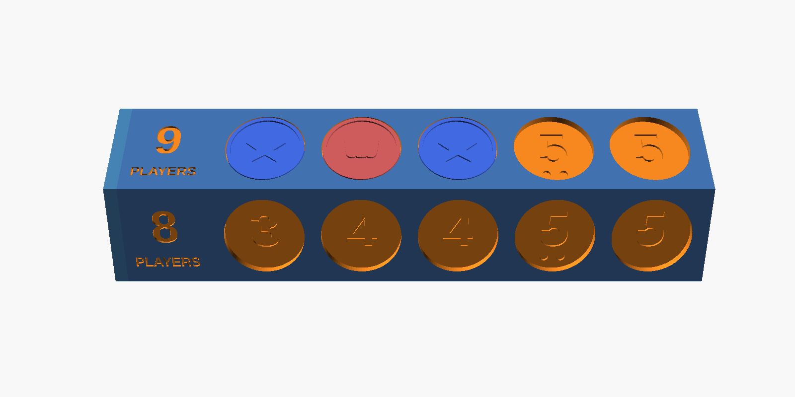
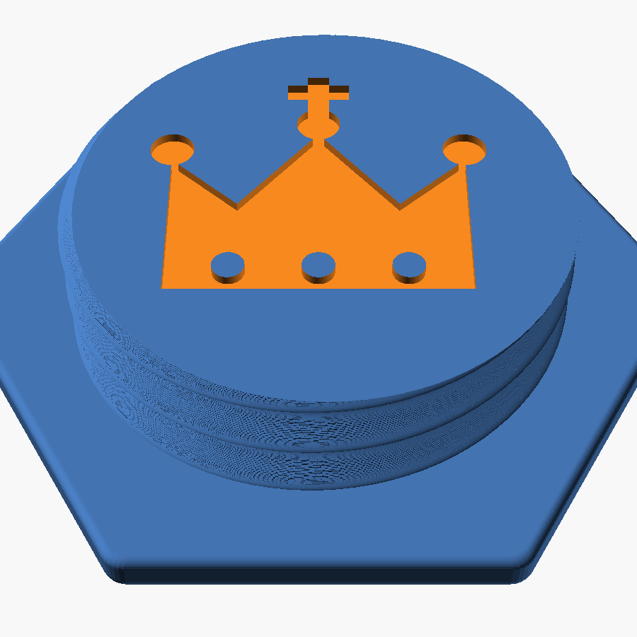

# Super Avalon 64

A 3D-printable coin set for a 5–10 player hidden-loyalty game in the style of
*The Resistance: Avalon*. Every role is a coin, and everything stores in one
hexagonal tube whose six faces double as the quest tracks for 5, 6, 7, 8, 9
and 10 players. All artwork is original and drawn in OpenSCAD.


## What's in the set

| Piece | File | Print | Notes |
|---|---|---|---|
| Merlin | `stl/coins/merlin.stl` | 1 | Good · "SEES EVIL" |
| Percival | `stl/coins/percival.stl` | 1 | Good · "SEES MERLIN" |
| Loyal Servant | `stl/coins/loyal_servant.stl` | **6** | Good · "SERVES ARTHUR" |
| Assassin | `stl/coins/assassin.stl` | 1 | Evil · "KILLS MERLIN" |
| Morgana | `stl/coins/morgana.stl` | 1 | Evil · "POSES AS MERLIN" |
| Mordred | `stl/coins/mordred.stl` | 1 | Evil · "UNSEEN BY MERLIN" |
| Oberon | `stl/coins/oberon.stl` | 1 | Evil · "UNKNOWN TO EVIL" |
| Minion | `stl/coins/minion.stl` | **4** | Evil · "SERVES MORDRED" |
| Lady of the Lake | `stl/coins/lady_of_the_lake.stl` | 1 | "REVEALS LOYALTY" |
| Loyalty: Good | `stl/coins/loyalty_good.stl` | 1 | for Lady of the Lake |
| Loyalty: Evil | `stl/coins/loyalty_evil.stl` | 1 | for Lady of the Lake |
| Quest: Success | `stl/coins/success.stl` | **5** | secret quest vote |
| Quest: Fail | `stl/coins/fail.stl` | **5** | secret quest vote |
| Round marker (star + GOOD / flame + EVIL) | `stl/coins/marker.stl` | **5** | two-sided, presses into a quest-track recess |
| Tube | `stl/tube/tube.stl` | 1 | |
| Screw lid | `stl/tube/lid.stl` | 1 | |

That is 16 role coins: all six special roles, plus 6 Loyal Servants and
4 Minions, so a 10-player game also works with no special roles at all.
There is one two-sided round marker per round: GOOD with a star on one face, EVIL with a flame on the other.

**Quests:** give each team member one Success and one Fail coin. They hand
one back face-down; shuffle and reveal. The backs are identical, so a vote
can't be read from behind. A team is never bigger than 5, so 5 of each is enough.

**Lady of the Lake:** hand the two loyalty coins to the player being
examined. They pass the one matching their side face-down to the Lady's
holder and keep the other hidden, so only loyalty is revealed, never the role.

Coins are 38 mm × 3 mm with rounded edges. Each front shows the role, its icon, GOOD/EVIL and a short line on what the
role does (in the quoted text above); the
backs all carry the same debossed pattern so coins can be dealt face-down.

## The tube



* Each face is one player count. The big number at the lid end is the player
  count, with the number of evil players (Minions of Mordred, specials
  included) engraved under it: 5→2, 6→2, 7→3, 8→3, 9→3, 10→4; below it are five recesses for rounds 1–5, top to bottom.
* The floor of each recess is engraved with that round's team size.
  Round 4 with 7+ players has **two dots** under the number: that quest only
  fails with two Fail votes.
* Lay the tube on the table with your player count facing up and drop a star
  (Good) or flame (Evil) marker into the round's recess once it's resolved.
  The markers are a snug press fit (0.15 mm per side) and sit flush with the face.

| Players | R1 | R2 | R3 | R4 | R5 |
|---|---|---|---|---|---|
| 5 | 2 | 3 | 2 | 3 | 3 |
| 6 | 2 | 3 | 4 | 3 | 4 |
| 7 | 2 | 3 | 3 | 4•• | 4 |
| 8 | 3 | 4 | 4 | 5•• | 5 |
| 9 | 3 | 4 | 4 | 5•• | 5 |
| 10 | 3 | 4 | 4 | 5•• | 5 |

Inside, from the bottom: a pocket that holds the five markers snugly, then the
stack of 29 coins (0.5 mm radial play, so they slide out freely), then the female thread. The lid's
threaded plug presses down on the stack, so nothing rattles. It's a rounded
single-start thread, 5 mm pitch, about 2½ turns; the hex lid lines up with the
tube faces when it is screwed home.

The base is engraved **AVALON** and the lid carries a compass star on top and
a **King's crown** on the inside: hand the lid to the current mission leader. All outside
edges are rounded: the six long corners (2 mm), the ends of the tube and lid,
and the mouth of every recess.

Overall size closed: 54.6 mm across flats, 63 mm across corners, 191.5 mm tall.
Everything in the set (29 coins and 5 markers) fits inside. The cavity is only as deep as the set needs; the rest of the tube is solid, so
print it with low infill (10–15 %) to save filament.



## Printing

* **Coins:** face up, no supports. The artwork and rim are a 0.6 mm raised layer:
  add a filament change at **2.4 mm** for two-colour faces. Suggested colours:
  blue for Good roles, red for Evil roles, anything for the Lady and the quest coins.
* **Round markers:** flat, no supports. Both faces are engraved 0.6 mm deep
  (EVIL underneath), so fill the engraving with paint (blue star side, red
  flame side) for contrast. If they're too tight in the recesses, raise the
  `0.3` in `recess_d` in `scad/config.scad`.
* **Tube:** upright, lid end up, no supports (the recesses are shallow enough
  to bridge). 0.2 mm layers are fine.
* **Lid:** already oriented plate-down in the STL.
* If the coins are too tight (or too loose) on your printer, change `fit_clearance`; if the
  lid is too tight or loose, change `thread_fit`.

## Editing

All sizes live in [`scad/config.scad`](scad/config.scad) (coin size, piece
counts, clearances, thread, quest table). After changing anything:

```sh
./scripts/export.sh          # rebuild every STL (OpenSCAD 2021.01+, Liberation fonts)
python3 scripts/check_fit.py # verify watertight meshes, bore fit and stack height; writes binary STLs
```

`check_fit.py` needs `pip install trimesh rtree`.

* `scad/coins.scad` – all coins; `-D 'part="merlin"'` etc. renders one,
  `part="art"` lays out every face flat.
* `scad/tube.scad` – tube (`part="tube"`), lid (`part="lid"`) or the
  closed assembly (default).
