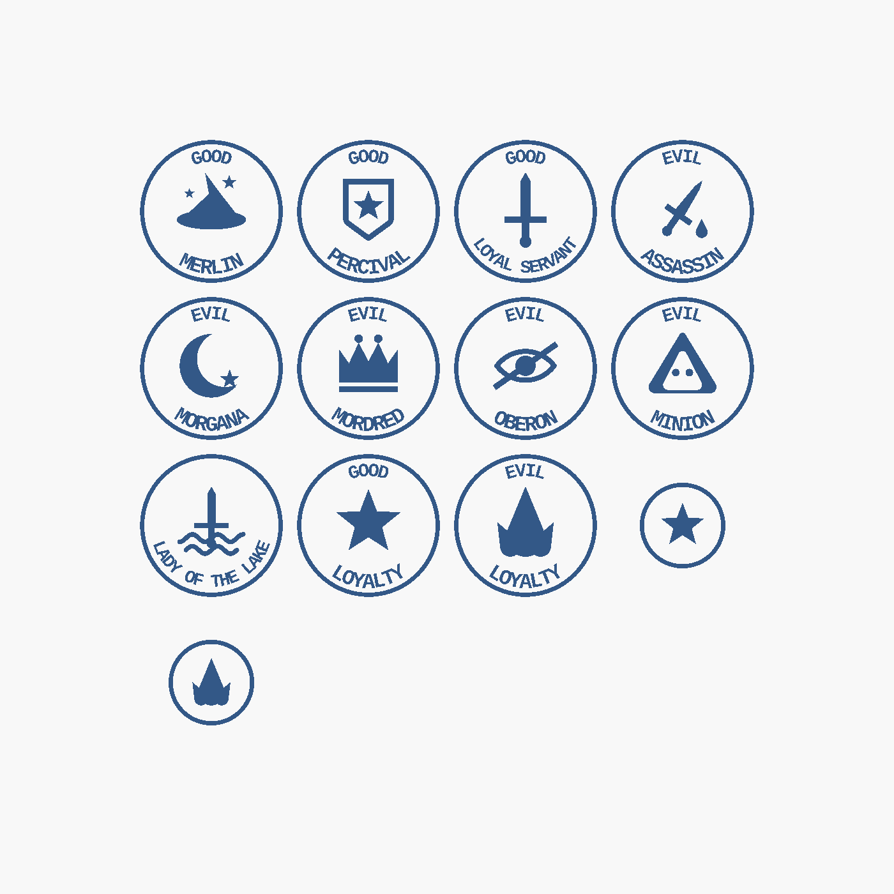

# Super Avalon 64

A 3D-printable coin set for a 5–10 player hidden-loyalty game in the style of
*The Resistance: Avalon*. Every role is a coin, and everything stores in one
hexagonal tube whose six faces double as the quest tracks for 5, 6, 7, 8, 9
and 10 players. All artwork is original and drawn in OpenSCAD.



## What's in the set

| Piece | File | Print | Notes |
|---|---|---|---|
| Merlin | `stl/coins/merlin.stl` | 1 | Good |
| Percival | `stl/coins/percival.stl` | 1 | Good |
| Loyal Servant | `stl/coins/loyal_servant.stl` | **6** | Good |
| Assassin | `stl/coins/assassin.stl` | 1 | Evil |
| Morgana | `stl/coins/morgana.stl` | 1 | Evil |
| Mordred | `stl/coins/mordred.stl` | 1 | Evil |
| Oberon | `stl/coins/oberon.stl` | 1 | Evil |
| Minion | `stl/coins/minion.stl` | **4** | Evil |
| Lady of the Lake | `stl/coins/lady_of_the_lake.stl` | 1 | |
| Loyalty: Good | `stl/coins/loyalty_good.stl` | 1 | for Lady of the Lake |
| Loyalty: Evil | `stl/coins/loyalty_evil.stl` | 1 | for Lady of the Lake |
| Good round marker (star) | `stl/coins/marker_good.stl` | **3** | goes in a quest-track recess |
| Evil round marker (flame) | `stl/coins/marker_evil.stl` | **3** | goes in a quest-track recess |
| Tube | `stl/tube/tube.stl` | 1 | |
| Screw lid | `stl/tube/lid.stl` | 1 | |

That is 16 role coins: all six special roles, plus 6 Loyal Servants and
4 Minions, so a 10-player game also works with no special roles at all.
A game ends after three wins for one side, so 3 markers per side is enough.

**Lady of the Lake:** hand the two loyalty coins to the player being
examined. They pass the one matching their side face-down to the Lady's
holder and keep the other hidden, so only loyalty is revealed, never the role.

Coins are 40 mm × 3 mm. Each front shows the role, its icon and GOOD/EVIL; the
backs all carry the same debossed pattern so coins can be dealt face-down.

## The tube


* Each face is one player count. The big number at the lid end is the player
  count; below it are five recesses for rounds 1–5, top to bottom.
* The floor of each recess is engraved with that round's team size.
  Round 4 with 7+ players has **two dots** under the number: that quest only
  fails with two Fail votes.
* Lay the tube on the table with your player count facing up and drop a star
  (Good) or flame (Evil) marker into the round's recess once it's resolved.
  The markers sit flush with the face.

| Players | R1 | R2 | R3 | R4 | R5 |
|---|---|---|---|---|---|
| 5 | 2 | 3 | 2 | 3 | 3 |
| 6 | 2 | 3 | 4 | 3 | 4 |
| 7 | 2 | 3 | 3 | 4•• | 4 |
| 8 | 3 | 4 | 4 | 5•• | 5 |
| 9 | 3 | 4 | 4 | 5•• | 5 |
| 10 | 3 | 4 | 4 | 5•• | 5 |

Inside, from the bottom: a pocket that holds the six markers snugly, then the
stack of 19 coins (0.3 mm radial play), then the female thread. The lid's
threaded plug presses down on the stack, so nothing rattles. It's a rounded
single-start thread, 5 mm pitch, about 2½ turns; the hex lid lines up with the
tube faces when it is screwed home.

Overall size closed: 54.6 mm across flats, 63 mm across corners, 183 mm tall.
The cavity is only as deep as the set needs; the rest of the tube is solid, so
print it with low infill (10–15 %) to save filament.

## Printing

* **Coins:** face up, no supports. The artwork and rim are a 0.6 mm raised layer:
  add a filament change at **2.4 mm** (coins) / **1.8 mm** (markers) for
  two-colour faces. Suggested colours: blue for Good roles and star markers,
  red for Evil roles and flame markers, anything for the Lady.
* **Tube:** upright, lid end up, no supports (the recesses are shallow enough
  to bridge). 0.2 mm layers are fine.
* **Lid:** already oriented plate-down in the STL.
* If the coins are too tight on your printer, raise `fit_clearance`; if the
  lid is too tight or loose, change `thread_fit`.

## Editing

All sizes live in [`scad/config.scad`](scad/config.scad) (coin size, piece
counts, clearances, thread, quest table). After changing anything:

```sh
./scripts/export.sh          # rebuild every STL (OpenSCAD 2021.01+, Liberation fonts)
python3 scripts/check_fit.py # verify watertight meshes, bore fit and stack height; writes binary STLs
```

`check_fit.py` needs `pip install trimesh rtree`.

* `scad/coins.scad` – all coins; `-D 'part="merlin"'` etc. renders one,
  `part="art"` lays out every face flat.
* `scad/tube.scad` – tube (`part="tube"`), lid (`part="lid"`) or the
  closed assembly (default).
